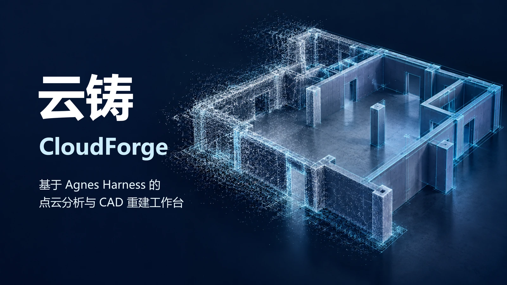
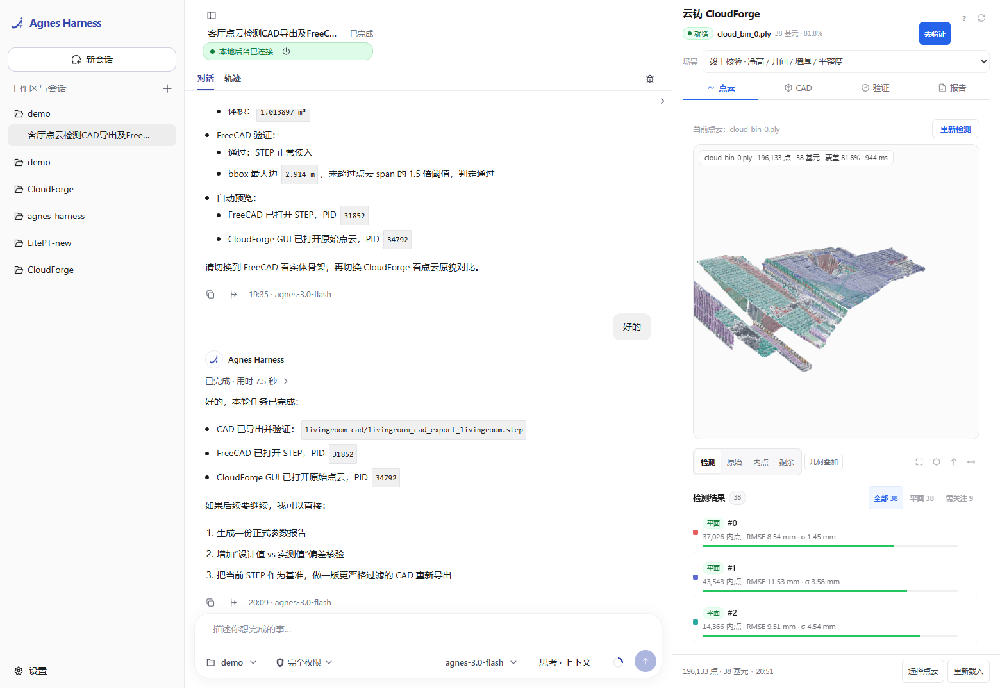
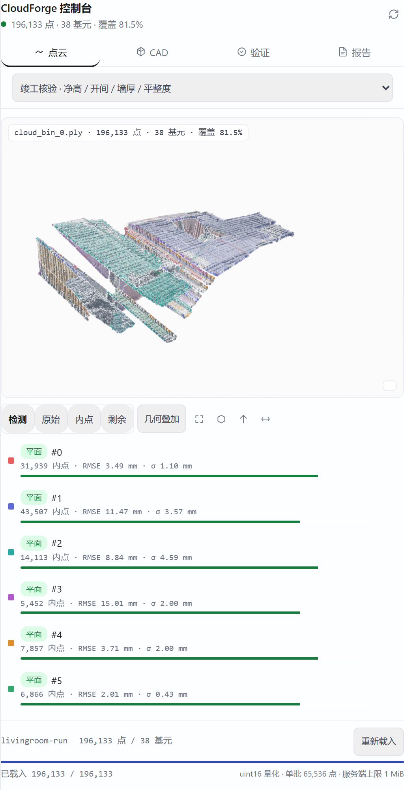
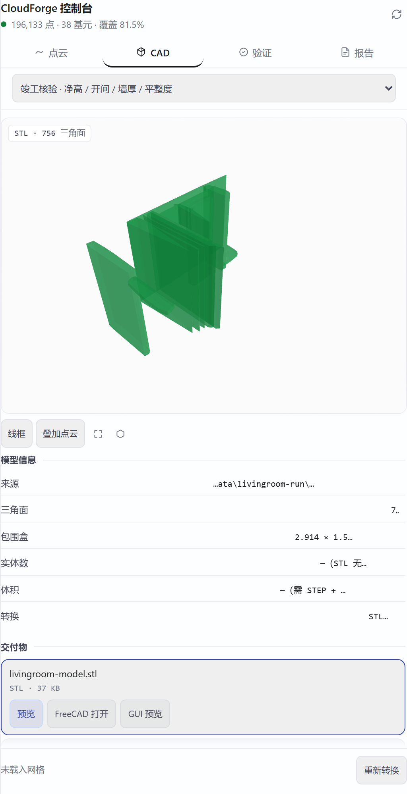
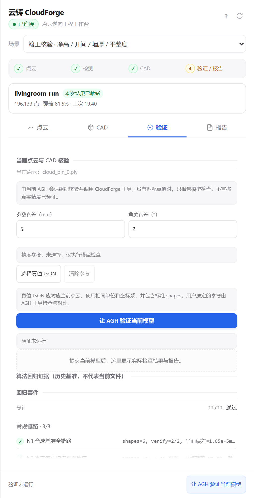
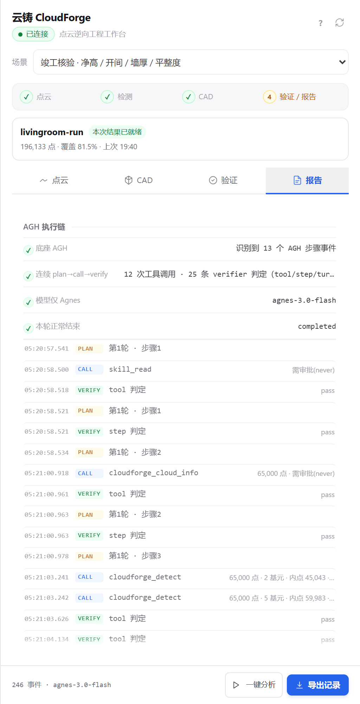
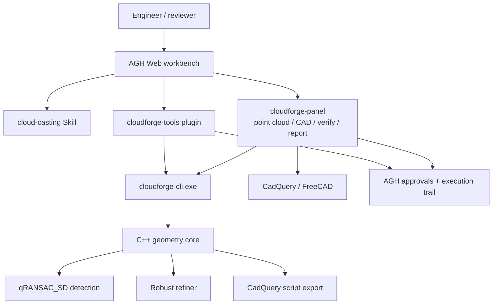

# CloudForge (云铸)

English | [简体中文](README.zh-CN.md)

**Repository:** [github.com/Su-yu-s/CloudForge](https://github.com/Su-yu-s/CloudForge)

<p align="center">
  
</p>

<div align="center">

### From point clouds to auditable physical parameters

**An Agnes Harness-powered agentic workbench for point-cloud reverse engineering, geometric verification, and CAD delivery.**


[Project overview](#project-overview) · [Demo video](#demo-video) · [Architecture](#architecture) · [Integration standards](#integration-standards) · [Quick start](#quick-start) · [Repository layout](#repository-layout) · [Licensing](#licensing-and-third-party-notices)

<sub>2026 Jiangsu Province University AI + Science & Engineering Innovation Practice Hackathon · Undergraduate Group · Track D (Engineering Design and the Digital World) · Direction D3 (3D Design and Spatial Intelligence)</sub>

</div>

## Project Overview

CloudForge (云铸, "cloud casting") turns a 3D scan into a set of geometric parameters, an editable CAD model, and a verification report. It was built for the **2026 Jiangsu Province University AI + Science & Engineering Innovation Practice Hackathon** (Undergraduate Group, Track D, Direction D3).

### Why this project

3D laser scanning has become fast: a single station can capture a scene in minutes, and point spacing is often below a millimetre. Post-processing has not kept up. Turning a scan into usable dimensions still means manually fitting surfaces, comparing numbers, and writing reports. The result is slow, subjective, and difficult to audit.

Jiangsu's smart-construction policy explicitly calls for **3D digital completion acceptance filing** and **BIM delivery standards**. Those workflows need structured parameters, not another point cloud. CloudForge bridges that gap: it makes the path from scan to parameter explicit, tool-driven, and reviewable.

### What it does

- **Agent-led workflow.** A `cloud-casting` Skill guides an Agnes Harness agent through inspection, detection, feedback/retry, verification, and optional CAD delivery. The agent plans and explains; the geometry itself is computed by deterministic C++.
- **Five geometric primitives.** Schnabel qRANSAC_SD detects planes, spheres, cylinders, cones, and tori. A robust refiner then re-fits each primitive and reports RMSE, robust noise sigma, and a soft inlier score.
- **Scene presets.** `outdoor` focuses on architectural planes; `mechanical` enables all five primitives. The same engine supports completion checks, mechanical segments, and heritage-component documentation.
- **Verification with a real boundary.** When ground truth is available, `verify` compares parameters and angles and returns an explicit pass/fail. When it is not, the system reports only what it can actually check and keeps `precisionVerified=false`.
- **CAD delivery.** Detection results become an executable CadQuery script, then STEP/STL. Building scans use a wall/floor/ceiling skeleton route; mechanical parts use parametric primitive solids. The exported model is checked for validity, units, bounds, and mesh coverage.
- **A workbench, not a black box.** The AGH right-side panel has four tabs: point cloud, CAD, verification, and report. It shows the current input, primitive list, fit evidence, CAD preview, verification request, and the actual AGH execution chain.
- **A guided workbench layout.** A four-step flow strip, a current-result summary, one primary action per tab, and progressive disclosure keep the 38-row detection list readable in a 512 px AGH panel.
- **Audit trail by default.** Tool calls, approvals, and results stay in the AGH session. The panel exports the real execution record instead of fabricating a trace.

### What is new here

1. **An execution chain as a first-class deliverable.** The agent plans, calls tools, reads the metrics, retries weak fits, and verifies the result. Each step is recorded in AGH and can be exported as evidence.
2. **Auditable geometry rather than a single number.** Every primitive carries its inlier count, RMSE, robust sigma, and soft score. A failed check is reported as a failure.
3. **One engine, three industry report profiles.** Completion acceptance, ship/mechanical segments, and cultural-heritage components use the same geometry core with different report semantics.
4. **A deterministic core behind an LLM planner.** The Agnes model handles planning and explanation; the C++ core handles geometry. No model is called inside the measurement path.
5. **A panel built around AGH's real constraints.** The client module respects the 1 MiB service budget, 30 s service timeout, CSP restrictions, and paginated binary transport instead of assuming a conventional web backend.

## Demo Video

**Watch the 5 min 38 s demo on Bilibili:** [https://b23.tv/wLaIodS](https://b23.tv/wLaIodS)

Direct video ID: [BV19spk6vEL9](https://www.bilibili.com/video/BV19spk6vEL9/)

**In-repo 720p preview:** [docs/assets/cloudforge-demo-720p.mp4](docs/assets/cloudforge-demo-720p.mp4) (13 MB, H.264/AAC)

[](https://b23.tv/wLaIodS)

The demo walks through the complete story:

1. The policy and industry problem: point clouds are abundant, but usable parameters are not.
2. The AGH workbench and the CloudForge panel.
3. A live agent session using `cloud-casting` and the `cloudforge_*` tools.
4. Detection results with fit evidence, followed by CAD generation and preview.
5. Verification and the exported execution record.

The Bilibili upload is the canonical streaming copy. A 720p preview is included in the repository; the 72.8 MB master is not committed.

## Screenshots from the Live Run

These screenshots were captured from the **real AGH Web workbench** at `http://127.0.0.1:4177/` with the installed CloudForge client module and the locally configured `agnes-3.0-flash` model. The panel loaded the bundled `livingroom-run` result: **196,133 points, 38 primitives, 81.5% coverage**. The CAD tab rendered the **756-triangle** preview mesh.



<sub>The left side is the real AGH session and trajectory; the right side is the CloudForge panel. The chat content is a prior CloudForge demo session.</sub>

<details>
<summary><b>Open the four panel tabs</b> (point cloud / CAD / verification / report)</summary>

| Point cloud | CAD |
| --- | --- |
|  |  |
| **Verification** | **Report** |
|  |  |

</details>

The live run demonstrates:

- **Point cloud:** the actual 196,133-point cloud with per-primitive inlier coloring, RMSE, robust sigma, and a 38-row primitive list.
- **CAD:** the panel reads `livingroom-model.stl` directly and reports 756 triangles and a 2.914 × 1.595 × 1.527 m bounding box.
- **Verification:** the regression suite reports **11/11 PASS** and the noise × sampling robustness grid; the form still states that no ground truth means no precision certificate.
- **Report:** the panel shows the real AGH execution chain: 12 tool calls, 25 tool/step/turn verifier judgments, and the `agnes-3.0-flash` model.

> The standalone preview at `hackathon/cloudforge-panel/tools/preview.mjs` is an offline UI harness; it deliberately bypasses AGH. The screenshots above come from the real AGH workbench, not the preview.

## Architecture



### Three layers

| Layer | Main paths | Responsibility |
| --- | --- | --- |
| **Agent orchestration** | `agnes-harness/`, `CloudForge/.agh/skills/cloud-casting/` | Sessions, planning, approvals, tool governance, Skills, execution records |
| **Tool and CLI integration** | `CloudForge/hackathon/cloudforge-tools/`, `CloudForge/hackathon/cli/`, `CloudForge/hackathon/cloudforge-panel/` | Seven AGH tools, a JSON CLI, and the four-tab workbench panel |
| **Geometry core** | `CloudForge/src-tauri/cpp/`, `CloudForge/src-tauri/src/` | qRANSAC_SD detection, robust refinement, C ABI/FFI, Tauri commands, desktop UI |

`agnes-harness/` is a vendored copy of the upstream Agnes Harness source with the project's Windows fixes. Build this copy rather than checking out an older upstream revision.

### Core pipeline

1. **Inspect** - `cloudforge_cloud_info` reports point count, bounding box, span, format, and whether the loader centered the cloud.
2. **Detect** - `cloudforge_detect` runs qRANSAC_SD with the selected preset, then re-fits each accepted primitive. Results include coefficients, inlier counts, RMSE, robust sigma, and soft score.
3. **Feedback and retry** - the Skill inspects the metrics. Weak primitives can be re-fitted with `cloudforge_refine` on their inlier subset. A selection below 50 points is rejected by the core; the agent reports that honestly instead of forcing a result.
4. **Verify** - `cloudforge_verify` compares a result against a truth file, including cylinder-to-cone equivalent-radius matching. In the workbench, `cloudforge_verify_current` executes the current request through a live AGH session and writes `verify.json` and `verify-report.md`.
5. **CAD** - `cloudforge_cad_export` or the panel's CAD tab generates an executable CadQuery model and STEP/STL deliverables.
6. **Report and export** - the report tab combines the agent's explanation, scene-specific conversions, and the actual AGH execution chain. AGH's own export command produces the audit record.

### Implementation notes

- **Detection:** adaptive progressive qRANSAC_SD; thresholds are tuned from cloud resolution and scene scale; presets differ in enabled primitives, normal tolerance, and support rules.
- **Refinement:** up to seven Tukey IRLS iterations. Planes use weighted PCA, spheres use a weighted algebraic solve, and cylinders/cones/tori use damped non-linear least squares with geometric constraints.
- **Metrics:** RMSE is the geometric root-mean-square residual; `robust_sigma` is `1.4826 × MAD`; `soft_score` is a MAGSAC-style truncated Gaussian inlier ratio in `[0, 1]`.
- **CAD:** building scans use a floor/ceiling plus full-height wall skeleton; mechanical scans use planes as trimmed slabs and cylinders/cones/spheres as parametric solids. The panel checks empty solids, invalid geometry, units, source span, and mesh coverage before presenting a model.
- **Panel transport:** point clouds are paginated at 65,536 points per response using uint16 quantization and base64; meshes are paginated at 65,536 triangles. The panel uses AGH's query/effect service model and does not bypass its approval path.

## Integration Standards

### 1. Agent integration: AGH plugin

The backend plugin lives in `CloudForge/hackathon/cloudforge-tools/`. It is an in-process AGH plugin declared in `package.json`:

```json
{
  "agnes": {
    "plugins": [
      { "export": "cloudforgeTools", "id": "ext:cloudforge/cloudforge-tools", "inject": ["extension"] }
    ]
  }
}
```

`index.mjs` registers tools with explicit input schemas and execution metadata. Read-only tools use `requiresApproval: "never"`; tools that write files or run long computations use `requiresApproval: "always"`, so the approval appears in the AGH trajectory. The plugin calls the CLI through `context.exec`, never through a shell string.

| Tool | Purpose | Access |
| --- | --- | --- |
| `cloudforge_cloud_info` | Point count, bounding box, span, format diagnostics | Read-only, no approval |
| `cloudforge_detect` | RANSAC detection plus robust fitting metrics; writes `result.json` and inlier indices | Writes output, approval required |
| `cloudforge_refine` | Re-fit a selected subset; `hint` narrows the primitive type; fewer than 50 points is refused | Writes output, approval required |
| `cloudforge_synth` | Generate a synthetic cloud with known ground truth | Writes output, approval required |
| `cloudforge_verify` | Compare a result with truth; reports parameter/angle errors and pass/fail | Read-only, no approval |
| `cloudforge_cad_export` | Convert detected primitives into an executable CadQuery script | Writes output, approval required |
| `cloudforge_verify_current` | Execute the current workbench verification request in a live AGH session | Compute/write, approval required |

The CLI is located in this order: `CLOUDFORGE_CLI`, then `hackathon/cli/build/Release/cloudforge-cli.exe` under the detected workspace. The workspace is discovered from `context.cwd`, `CLOUDFORGE_WORKSPACE`, or the module location. The CLI may print diagnostic lines before its JSON; the plugin parses from the first `{`.

### 2. CLI contract

`cloudforge-cli.exe` is a C++17 command-line shell over the geometry core. It is intentionally zero-dependency and emits JSON.

| Command | Purpose |
| --- | --- |
| `info <cloud>` | Cloud metadata and format diagnosis |
| `detect <cloud> [--preset outdoor\|mechanical] [--min-inlier N] [--output DIR] [--preserve-points] [--noise S] [--downsample R]` | Detect primitives and write result artifacts |
| `refine <cloud> --indices FILE [--hint plane\|sphere\|cylinder\|cone\|torus\|unknown] [--output DIR]` | Re-fit a point subset |
| `synth <out.pcd> [--scene plane-cylinder]` | Generate a synthetic benchmark with truth |
| `verify --truth FILE --result FILE [--tol R] [--angle-deg A]` | Compare result against truth |
| `cad <cloud> --result result.json --out model.py [--step model.step] [--ids 0,2,3] [--hull] [--union] [--min-inlier N]` | Generate a CadQuery model |

All commands return a JSON envelope with `ok`. A business failure still returns JSON, typically with `ok:false` and `error`; verify returns `pass:false` and exit code `2`. A successful `detect --output` writes:

```text
<output_dir>/
  result.json
  indices/
    shape_0.txt
    shape_1.txt
    ...
    remaining.txt
```

Example `detect` output (values from the bundled living-room run, rounded):

```json
{
  "ok": true,
  "preset": "mechanical_full",
  "points": 196133,
  "shape_count": 38,
  "inlier_point_sum": 159812,
  "remaining_count": 36321,
  "shapes": [
    {
      "id": 0,
      "type": "Plane",
      "type_id": 0,
      "inlier_count": 31939,
      "rmse": 0.00349,
      "robust_sigma": 0.00110,
      "soft_score": 0.8327,
      "coefficients": [0.004708, 0.999830, 0.017853, -2.439889]
    }
  ]
}
```

### 3. Data contract

**Supported inputs:** PLY (ASCII and binary little-endian), PCD (ASCII and binary), TXT (first three floats per line), STL (ASCII and binary), OBJ (`v` lines), and NuScenes BIN (`float32` N×5 records). PLY vertex lists with `list` properties, PCD `binary_compressed`, and big-endian PLY are not supported.

**Coordinates and units:** coefficients use the cloud's coordinate units, which are metres for the bundled demo data. The GUI and panel use a Z-up view convention. PLY/PCD/BIN preserve the source frame. TXT and STL are centroid-centered by the core; reports state this explicitly. In the workbench, detected point indices refer to the same ordered cloud used for preview.

**Coefficient layouts** (all values are `float32` in the CLI JSON):

| Primitive | Layout |
| --- | --- |
| Plane | `[nx, ny, nz, d]`, unit normal, `n·p + d = 0` |
| Sphere | `[cx, cy, cz, r]` |
| Cylinder | `[px, py, pz, ax, ay, az, r]` - axis point, unit axis, radius |
| Cone | `[apexX, apexY, apexZ, ax, ay, az, halfAngle(rad)]` - apex first |
| Torus | `[minorR, majorR, cx, cy, cz, nx, ny, nz]` - minor radius first |

**`result.json` fields:** `ok`, `source_cloud`, `input_point_count`, `shape_count`, `inlier_point_sum`, `remaining_count`, and `shapes[]`. Each shape has `id`, `type`, `type_id`, `inlier_count`, `rmse`, `robust_sigma`, `soft_score`, and `coefficients`. Inlier index files contain one 0-based point index per line.

**Verification output:** `ok`, `pass`, `matched`, `total`, `tolerance`, `angle_tolerance_deg`, and `checks[]`. Each check records the truth id, matched shape, match kind, parameter error, angle error, and pass flag.

### 4. Workbench service contract

The panel is an AGH client module declared in `extensions/main/agnes.client.json`:

```json
{
  "client": {
    "entry": "./client/bundle/index.js",
    "slots": ["workbench.panel", "conversation.session.header.corner"],
    "slotCatalogVersion": "dsh-client-slots/v1",
    "services": ["cloudforge.report", "cloudforge.cloud", "cloudforge.cad", "..."]
  }
}
```

It registers 20 services. The contract is enforced by AGH:

| Constraint | Value |
| --- | --- |
| Response size | `maxResultBytes` ≤ 1,048,576 |
| Timeout | `timeoutMs` ≤ 30,000 |
| Service kind | `query` or `effect` only |
| Output schema | Required and validated on every call |
| Write actions | `effect` services are executed through registered commands and a user confirmation |
| Assets | Same-origin `.js/.mjs/.css/.map`; no inline styles or scripts under the panel CSP |

Point clouds are split into 65,536-point pages. The span is quantized to uint16, which gives about 0.05 mm precision for a 3.4 m room, well below the fitting noise. The panel requires an active AGH session for backend queries; the first file pick calls `ctx.session.ensureActive()` without sending a model prompt.

### 5. Environment and version matrix

| Dependency | Requirement |
| --- | --- |
| OS | Windows 10/11 x64 |
| Visual Studio | 2022 or Build Tools with the Desktop C++ workload, MSVC x64, Windows SDK |
| CMake | ≥ 3.15 |
| Node.js | ≥ 24.10 (recorded environment: 24.21.0) |
| pnpm | 10.34.5 |
| Python | 3.12 x64 |
| CadQuery / NumPy / SciPy | 2.6.1 / 2.2.6 / 1.15.3 |
| Rust | Stable MSVC toolchain (optional, desktop GUI only) |
| FreeCAD | Optional, for external STEP inspection |
| Eigen | 5.0.1, included in `src-tauri/cpp/third_party/` |

The exact Windows build sequence is documented in [复现指南.md](复现指南.md) (Chinese) and summarized below.

## Quick Start

### Prerequisites

Install the toolchain above. The geometry build needs the **x64 Visual Studio developer environment**. The research-only `ransac_sd` source is **not** redistributed; obtain it from the upstream PrimitiveShapes/qRANSAC_SD distribution and place it at:

```text
CloudForge/src-tauri/cpp/third_party/ransac_sd/
```

The directory must contain `CMakeLists.txt` with the target `QRANSAC_SD_PRIM_SHAPES_LIB`, plus `MiscLib/`, `GfxTL/`, and the detector sources. CMake stops if it is missing. See [CloudForge/src-tauri/cpp/third_party/README.md](CloudForge/src-tauri/cpp/third_party/README.md).

### 1. Clone and build the CLI

```powershell
git clone https://github.com/Su-yu-s/CloudForge.git
Set-Location CloudForge
cmake -S CloudForge/hackathon/cli -B CloudForge/hackathon/cli/build -G "Visual Studio 17 2022" -A x64
cmake --build CloudForge/hackathon/cli/build --config Release
```

The build produces `cloudforge-cli.exe` and `cloudforge-picker.exe` under `CloudForge/hackathon/cli/build/Release/`.

### 2. Install the frontend and CAD environment

```powershell
Set-Location CloudForge
npm.cmd ci
py -3.12 -m venv .venv-cad
& .\.venv-cad\Scripts\python.exe -m pip install -r ..\CAD依赖锁定-Windows-Python312.txt
```

The panel and CAD tools discover the project `.venv-cad` by default. Set `CLOUDFORGE_PYTHON` to use another interpreter.

### 3. Build the bundled AGH

```powershell
Set-Location ..\agnes-harness
npm.cmd install --global pnpm@10.34.5
pnpm.cmd install --frozen-lockfile
$taskNodeVersion = node -p "process.versions.node"
$taskNodeArch = node -p "process.arch"
$taskNodeCache = Join-Path $env:LOCALAPPDATA 'node-gyp\Cache'
npm.cmd exec --yes --package=node-gyp -- node-gyp install "--target=$taskNodeVersion" "--arch=$taskNodeArch" "--devdir=$taskNodeCache"
pnpm.cmd --filter @agnes/cli build:local
```

The runnable output is in `agnes-harness/packages/cli/dist/local/`.

### 4. Allow the workbench service capability

The CloudForge panel needs the `services` capability. Add it to the user profile at `%USERPROFILE%\.agh\profiles\local-dev\profile.yaml`. If the file already exists, merge it into the existing `policy.capabilityCeiling`; do not replace personal settings.

```yaml
name: local-dev
schemaVersion: 1
policy:
  capabilityCeiling: ["tools", "hooks", "slots", "events", "resources", "ui", "network", "network.publicRead", "tools.invoke", "artifacts", "subagent", "services"]
  workspacePackages: require-project-trust
```

### 5. Start AGH and install the CloudForge packages

```powershell
Set-Location ..\CloudForge
$env:AGNES_PROFILE = 'local-dev'
node ..\agnes-harness\packages\cli\dist\local\agnes.mjs serve --port 4177
```

Keep this terminal running. In a second terminal:

```powershell
Set-Location CloudForge
$env:AGH_PROFILE = 'local-dev'
$env:AGH_ROOT = (Resolve-Path ..\agnes-harness).Path
node ..\agnes-harness\packages\cli\dist\local\agnes.mjs profile trust (Get-Location).Path
node hackathon/cloudforge-panel/tools/build-client.mjs
$tsx = '..\agnes-harness\node_modules\.bin\tsx.cmd'
& $tsx hackathon/agh-scripts/update-cloudforge-tools.mts
& $tsx hackathon/agh-scripts/install-package.mts "file:./hackathon/cloudforge-panel" "cloudforge-panel"
```

Open `http://127.0.0.1:4177/`, trust the CloudForge workspace, enable the `cloud-casting` Skill, and configure your own Agnes model in **Settings**. The repository does not contain model keys, passwords, or a shared account.

If AGH stops with `credential store is unavailable`, remove the sandbox-injected ACE from the AGH home. This was required on the machine used for the live screenshots:

```powershell
icacls "$env:USERPROFILE\.agh" /remove:g SU\CodexSandboxUsers
```

Only remove this ACE if it exists. It is the documented fix in [PANEL-AGH.md](CloudForge/hackathon/cloudforge-panel/PANEL-AGH.md) and does not touch sessions or credential files.

### 6. Run a demo

Use the bundled small samples first:

| File | Purpose |
| --- | --- |
| `CloudForge/hackathon/demo-data/cloud_bin_0.ply` | Real indoor scan fragment |
| `CloudForge/hackathon/demo-data/cad-test/part.pcd` | Synthetic mechanical part |
| `CloudForge/hackathon/demo-data/cad-test/part.truth.json` | Ground truth for the synthetic part |
| `data/livingroom1-fragments-ply/` | Full living-room fragments |
| `data/office1-fragments-ply/` | Full office fragments |

In the panel, choose a cloud and run detection. For the full agent path, start a session and ask it to analyze the file with the `cloud-casting` workflow. Then inspect the verification and report tabs. For a desktop GUI build:

```powershell
Set-Location CloudForge
npm.cmd run tauri build -- --no-bundle
```

The full Windows troubleshooting guide is [复现指南.md](复现指南.md). Panel integration constraints are in [CloudForge/hackathon/cloudforge-panel/PANEL-AGH.md](CloudForge/hackathon/cloudforge-panel/PANEL-AGH.md).

## Repository Layout

| Path | Contents |
| --- | --- |
| `CloudForge/` | Vue 3 / Three.js workbench, Tauri 2 desktop shell, Rust and C++ core, Python CAD tools |
| `CloudForge/hackathon/cloudforge-tools/` | AGH backend plugin with seven agent tools |
| `CloudForge/hackathon/cloudforge-panel/` | AGH client module: point cloud / CAD / verification / report tabs |
| `CloudForge/hackathon/cli/` | `cloudforge-cli.exe` and the native file picker |
| `CloudForge/.agh/skills/cloud-casting/` | The agent workflow Skill |
| `CloudForge/src-tauri/cpp/` | C++ geometry core and the C ABI shim |
| `agnes-harness/` | Vendored Agnes Harness source with project fixes |
| `data/` | Redwood/3DMatch indoor scans and Open3D demo fragments |
| `deliverables/` | Posters, policy page, and presentation assets |
| `docs/assets/` | README visuals, live-run screenshots, and the 720p demo preview |
| `复现指南.md` | Detailed Windows reproduction guide (Chinese) |
| `BUILD-CHECKLIST.md` | Historical build log and known Windows issues |
| `依赖清单.txt`, `CAD依赖锁定-Windows-Python312.txt` | Toolchain and Python dependency snapshots |

## Validation Snapshot

These are recorded results from the repository's test artifacts, not a fresh run on every machine. Re-run the commands to produce current results.

| Check | Recorded result | Artifact |
| --- | --- | --- |
| Synthetic benchmark (65,000 points: plane + cylinder) | Plane parameter error ≈ 1.6 × 10⁻⁵ m; cylinder equivalent-radius error < 1 mm | `CloudForge/hackathon/tests/results/` |
| Real indoor scan (196,133 points) | 38 plane primitives; 159,812 inlier points (≈ 81.5%) | `CloudForge/hackathon/demo-data/livingroom-run/result.json` |
| CAD delivery (synthetic part) | Recorded STEP bounding box 0.600 × 0.600 × 0.206 vs truth 0.6 × 0.6 × 0.2; the STEP is generated at runtime | `CloudForge/hackathon/demo-data/cad-test/` (source and truth) |
| Test suite | 11 / 11 PASS (normal, boundary, failure cases) | `CloudForge/hackathon/tests/results/suite-result.json` |
| Tool self-test | 7 / 7 PASS | `CloudForge/hackathon/cloudforge-tools/tools.test.mjs` |

The test suite also records a 986 ms detection for a comparable 196k-point run. Timing varies by machine, input, and preset.

## Live Verification (2026-10-28)

This section records a fresh run on the development machine, separate from the historical artifacts above.

| Item | Value |
| --- | --- |
| OS | Windows 10/11 x64 |
| Node.js / pnpm | 24.15.0 / 10.34.5 |
| CMake / MSVC | 4.3.0 / MSVC 14.51.36231 (portable Visual Studio 2022) |
| AGH | Built from `agnes-harness/` with `pnpm install --frozen-lockfile` and `pnpm --filter @agnes/cli build:local` |
| Model | `agnes-3.0-flash` (configured locally; no key is stored in the repository) |

### AGH and panel

- AGH started at `http://127.0.0.1:4177/`; the workbench reported **本地后台已连接** (local backend connected).
- The installed `cloudforge-panel` client module loaded `livingroom-run`: **196,133 points, 38 primitives, 81.5% coverage**.
- The CAD tab read `livingroom-model.stl`: **756 triangles**, bounding box **2.914 × 1.595 × 1.527 m**.
- The verification tab reported **11/11 PASS** for the regression suite plus the robustness grid.
- The report tab showed **12 tool calls**, **25 verifier judgments**, and model `agnes-3.0-flash`.

### Fresh CLI run

Commands (paths shortened):

```powershell
cloudforge-cli.exe info CloudForge/hackathon/demo-data/cloud_bin_0.ply
cloudforge-cli.exe detect CloudForge/hackathon/demo-data/cloud_bin_0.ply --preset outdoor --output <temp>/demo-detect
cloudforge-cli.exe synth <temp>/synth.pcd --scene plane-cylinder
cloudforge-cli.exe detect <temp>/synth.pcd --preset mechanical --output <temp>/synth-detect
cloudforge-cli.exe verify --truth <temp>/synth.truth.json --result <temp>/synth-detect/result.json --tol 0.005 --angle-deg 2
```

| Step | Result |
| --- | --- |
| `info` | 196,133 points; PLY; span 3.4075 m; `centered=false` |
| Real `detect` (outdoor) | **36 plane primitives**; 158,859 inliers; 37,274 remaining |
| `synth` | 65,000 points; plane + cylinder; truth JSON written |
| Synthetic `detect` (mechanical) | 5 primitives: 3 planes + 2 cones (cylinder generalized as cone) |
| Synthetic `verify` | **PASS 2/2**; plane error 1.649×10⁻⁵ m / 0.0059°; cylinder generalized error 5.93×10⁻⁴ m / 0.076° |

The panel uses the bundled 38-primitive `livingroom-run` artifact; the fresh CLI run produced 36 planes with the `outdoor` preset. Primitive counts vary with preset and preprocessing; the verification numbers above are from the fresh synthetic run.

> The CLI was built locally with the research-only `ransac_sd` source. That source and the build outputs are not committed.

## Scope, Honesty, and Known Boundaries

- **No ground truth means no precision certificate.** For a real scan without an independent reference, `verify` can check validity, indexing, fit residuals, CAD validity, units, and bounds, but it keeps `precisionVerified=false`. It must not claim a precision PASS.
- **The video and historical artifacts show past runs.** Re-select the bundled cloud and regenerate results before presenting them as current. Do not reuse an old PASS for a new input.
- **The legacy desktop segmentation path is separate.** The original GUI contains an optional local third-party segmentation model (LitePT). It is not part of the AGH execution chain or the hackathon demo, and no model is called by the geometry core.
- **The RANSAC source is research-only.** `ransac_sd` is not distributed here; the current tree also does not distribute compiled qRANSAC_SD binaries. Obtain the source under its own terms for a build.
- **Some historical documents reference developer-local paths.** They are retained as build records; a fresh clone does not depend on them. Use the project-relative paths in this README and the reproduction guide.
- **No secrets are committed.** Model credentials belong in the local AGH configuration. `.env`, AGH home directories, sessions, outputs, and local virtual environments are ignored. The vendored AGH test suite contains deliberately fake `sk-...` sentinel strings; they are test fixtures, not credentials.

## Licensing and Third-Party Notices

The project's own code is licensed under **Apache-2.0** (see [LICENSE](LICENSE)). Third-party components keep their original licenses:

| Component | License | Distribution |
| --- | --- | --- |
| Agnes Harness (AGH) | Apache-2.0 | Vendored in `agnes-harness/`; see [LICENSE](agnes-harness/LICENSE) and [NOTICE](agnes-harness/NOTICE) |
| qRANSAC_SD / PrimitiveShapes 1.1 (Schnabel & Wahl, University of Bonn) | Research use only; no redistribution right granted | Not included; obtain separately |
| Eigen 5.0.1 | MPL2 / BSD / Apache-2.0 (see its `COPYING.*`) | Included |
| CadQuery | Apache-2.0 | Installed as a Python dependency |
| Tauri 2 / Vue 3 / Vite / Three.js | MIT | Source and vendored panel assets |
| Redwood / 3DMatch indoor scans | Public research dataset; follow the upstream terms | `data/` |
| Open3D demo fragments (`DemoColoredICPPointClouds`) | Follow the Open3D data terms | `data/` |
| Synthetic point clouds | Generated by this project | `CloudForge/hackathon/demo-data/` |

The complete third-party inventory and the independence statement are in [CloudForge/hackathon/declaration.md](CloudForge/hackathon/declaration.md) and [CloudForge/src-tauri/cpp/third_party/README.md](CloudForge/src-tauri/cpp/third_party/README.md).

## Acknowledgements

CloudForge builds on Agnes Harness and the Agnes model, qRANSAC_SD by Ruwen Schnabel and Roland Wahl, Eigen, CadQuery, FreeCAD, Tauri, Vue, Vite, and Three.js. The demo data comes from the Redwood/3DMatch indoor scans and Open3D sample fragments. The project thanks the hackathon organizers and the open-source maintainers whose work made the pipeline possible.
