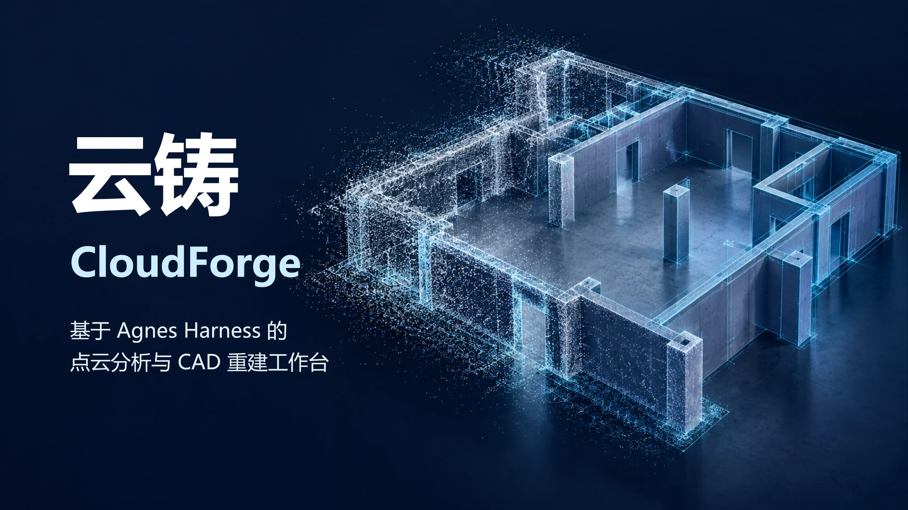
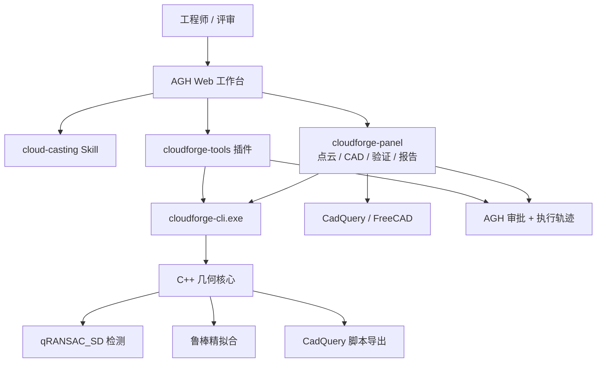

# 云铸 CloudForge

[English](README.md) | 简体中文

<p align="center">
  
</p>

<div align="center">

### 从点云到可复核的实体参数

**基于 Agnes Harness 的点云逆向工程、几何验证与 CAD 交付智能体工作台。**


[项目介绍](#项目介绍project-overview) · [视频介绍](#视频介绍demo-video) · [架构介绍](#架构介绍architecture) · [集成标准](#集成标准integration-standards) · [快速开始](#快速开始quick-start) · [目录结构](#目录结构repository-layout) · [许可](#许可与第三方说明licensing-and-third-party-notices)

<sub>2026 年江苏省高校 AI+科学与工程创新实践黑客松 · 本科生组 · 主赛道 D（工程设计与数字世界） · 方向 D3（3D 设计与空间智能）</sub>

</div>

## 项目介绍（Project Overview）

云铸 CloudForge 把一份三维扫描点云转化为一组几何参数、一个可编辑的 CAD 模型和一份可复核的验证报告。项目面向 **2026 年江苏省高校 AI+科学与工程创新实践黑客松**（本科生组，主赛道 D，方向 D3）。

### 项目背景

三维激光扫描的采集已经很快：单站可在数分钟内完成场景采集，点距常常小于 1 毫米。后处理却没有跟上。点云到手后，仍然需要人工逐面拟合、比对设计值、整理报告。这个过程慢、主观，而且难以审计。

江苏省智能建造政策明确要求开展**三维数字化竣工验收备案**、制定 **BIM 交付标准**。这些工作需要的不是又一份点云，而是结构化、可核验的参数。云铸补的正是这一段：把"扫描 → 参数"的路径显式化、工具化、可复核。

### 核心功能

- **智能体主导的工作流。** `cloud-casting` Skill 引导 Agnes Harness 智能体完成侦察、检测、反馈重试、验证和可选的 CAD 交付。智能体负责规划与解释，几何计算由确定性的 C++ 核心完成。
- **五类几何基元。** Schnabel qRANSAC_SD 检测平面、球、圆柱、圆锥和圆环；随后由鲁棒精拟合重新求解每个基元，并返回 RMSE、噪声 σ 和软评分。
- **场景预设。** `outdoor` 面向建筑平面，`mechanical` 开启五类基元。同一套引擎可服务竣工核验、船舶/机械分段和文物构件数字化。
- **有边界的验证。** 有真值时，`verify` 比较参数与角度并给出明确的通过/失败；没有真值时，系统只报告实际能检查的项，并保持 `precisionVerified=false`。
- **CAD 交付。** 检测结果生成可执行的 CadQuery 脚本，再导出 STEP/STL。建筑扫描走墙体/地板/顶棚骨架路线，机械零件走参数化基元实体路线；导出后会检查实体有效性、单位、包围盒和网格覆盖。
- **工作台而非黑盒。** AGH 右栏面板包含点云、CAD、验证、报告四个页签，展示当前输入、基元清单、拟合证据、CAD 预览、验证请求和真实的 AGH 执行链。
- **默认留痕。** 工具调用、审批和结果都保留在 AGH 会话中；面板导出真实执行记录，而不是伪造轨迹。

### 创新亮点

1. **把执行链本身作为交付物。** 智能体规划、调用工具、读取指标、对弱拟合重试并验证结果；每一步都记录在 AGH 中，可导出为证据。
2. **可审计的几何，而不是一个孤立的数字。** 每个基元都带内点数、RMSE、鲁棒 σ 和软评分；检查失败就如实报告失败。
3. **一个引擎，三份行业报告。** 竣工核验、船舶/机械分段、文物构件共用几何核心，但使用不同的报告语义与换算规则。
4. **确定性核心 + 大模型规划。** Agnes 模型负责规划与解释，C++ 核心负责几何；测量链路内部不调用任何模型。
5. **按 AGH 真实约束设计的面板。** 客户端模块遵守 1 MiB 服务预算、30 秒服务超时、CSP 限制和分页二进制传输，而不是假设一个常规 Web 后端。

## 视频介绍（Demo Video）

**B 站演示视频（5 分 38 秒）：** [https://b23.tv/wLaIodS](https://b23.tv/wLaIodS)

视频 BV 号：[BV19spk6vEL9](https://www.bilibili.com/video/BV19spk6vEL9/)

**仓库内 720p 预览：** [docs/assets/cloudforge-demo-720p.mp4](docs/assets/cloudforge-demo-720p.mp4)（13 MB，H.264/AAC）

[](https://b23.tv/wLaIodS)

视频按以下顺序展开：

1. 政策与行业问题：点云很多，可用参数很少。
2. AGH 工作台与云铸右栏面板。
3. 智能体使用 `cloud-casting` 与 `cloudforge_*` 工具完成一次真实会话。
4. 检测结果、拟合证据，以及 CAD 生成与预览。
5. 验证流程与导出的 AGH 执行记录。

B 站上传版本是正式流媒体版本；仓库内提供 720p 预览，72.8 MB 母版不随仓库提交。

## 架构介绍（Architecture）



### 三层结构

| 层级 | 主要路径 | 职责 |
| --- | --- | --- |
| **智能体编排层** | `agnes-harness/`、`CloudForge/.agh/skills/cloud-casting/` | 会话、规划、审批、工具治理、Skill、执行记录 |
| **工具与 CLI 集成层** | `CloudForge/hackathon/cloudforge-tools/`、`CloudForge/hackathon/cli/`、`CloudForge/hackathon/cloudforge-panel/` | 七个 AGH 工具、JSON CLI、四页签工作台面板 |
| **几何核心层** | `CloudForge/src-tauri/cpp/`、`CloudForge/src-tauri/src/` | qRANSAC_SD 检测、鲁棒精拟合、C ABI/FFI、Tauri 命令、桌面端 UI |

`agnes-harness/` 是随仓提供的 Agnes Harness 源码副本，包含本项目的 Windows 配套修复。请直接构建这一份，不要另行检出旧的上游提交。

### 核心流水线

1. **侦察**：`cloudforge_cloud_info` 返回点数、包围盒、跨度、格式，以及加载器是否做了质心居中。
2. **检测**：`cloudforge_detect` 按预设运行 qRANSAC_SD，再对每个保留基元做精拟合；输出系数、内点数、RMSE、鲁棒 σ 和软评分。
3. **反馈与重试**：Skill 检查指标。弱基元可以用 `cloudforge_refine` 在其内点子集上重新拟合；少于 50 个点的选择会被核心拒绝，智能体应如实报告，而不是强行给出结果。
4. **验证**：`cloudforge_verify` 将结果与真值比较，支持圆柱↔圆锥的等效半径泛化匹配。工作台中的 `cloudforge_verify_current` 通过活动 AGH 会话执行当前请求，并写入 `verify.json` 与 `verify-report.md`。
5. **CAD**：`cloudforge_cad_export` 或面板的 CAD 页生成可执行 CadQuery 模型，并导出 STEP/STL。
6. **报告与导出**：报告页组合智能体解释、场景换算和真实 AGH 执行链；AGH 自带的导出命令生成审计记录。

### 实现要点

- **检测**：自适应渐进式 qRANSAC_SD；阈值根据点云分辨率和场景尺度自动调整；不同预设启用不同基元、法向容差和支持度规则。
- **精拟合**：最多 7 轮 Tukey IRLS。平面用加权 PCA，球用加权代数求解，圆柱/圆锥/圆环用带几何约束的阻尼非线性最小二乘。
- **指标**：RMSE 是几何残差均方根；`robust_sigma` 为 `1.4826 × MAD`；`soft_score` 是 MAGSAC 风格的截断高斯软内点率，取值 `[0, 1]`。
- **CAD**：建筑扫描使用地板/顶棚 + 全高墙体骨架；机械扫描把平面裁成板片，把圆柱/圆锥/球生成为参数化实体。面板在展示模型前检查空实体、非法几何、单位、源点云跨度和网格覆盖。
- **面板传输**：点云按每页 65,536 点分页，使用 uint16 量化和 base64；网格按每页 65,536 个三角面分页。面板使用 AGH 的 query/effect 服务模型，不绕过审批通道。

## 集成标准（Integration Standards）

### 1. 智能体集成：AGH 插件

后端插件位于 `CloudForge/hackathon/cloudforge-tools/`，是 AGH 的进程内插件，在 `package.json` 中声明：

```json
{
  "agnes": {
    "plugins": [
      { "export": "cloudforgeTools", "id": "ext:cloudforge/cloudforge-tools", "inject": ["extension"] }
    ]
  }
}
```

`index.mjs` 注册工具时提供明确的输入 Schema 和执行元数据。只读工具设置 `requiresApproval: "never"`；写文件或长计算的工具设置 `requiresApproval: "always"`，审批会出现在 AGH 轨迹中。插件通过 `context.exec` 调用 CLI，不拼接 shell 字符串。

| 工具 | 用途 | 访问控制 |
| --- | --- | --- |
| `cloudforge_cloud_info` | 点数、包围盒、跨度、格式诊断 | 只读，免审批 |
| `cloudforge_detect` | RANSAC 检测 + 精拟合指标；写入 `result.json` 和内点索引 | 写输出，需审批 |
| `cloudforge_refine` | 对选中子集重新拟合；`hint` 限定基元类型；少于 50 点拒绝 | 写输出，需审批 |
| `cloudforge_synth` | 生成带已知真值的合成点云 | 写输出，需审批 |
| `cloudforge_verify` | 结果与真值比较，返回参数/角度误差和通过状态 | 只读，免审批 |
| `cloudforge_cad_export` | 把检测基元转换为可执行 CadQuery 脚本 | 写输出，需审批 |
| `cloudforge_verify_current` | 在活动 AGH 会话中执行当前工作台验证请求 | 计算/写输出，需审批 |

CLI 的查找顺序是 `CLOUDFORGE_CLI`，然后是工作区下的 `hackathon/cli/build/Release/cloudforge-cli.exe`。工作区从 `context.cwd`、`CLOUDFORGE_WORKSPACE` 或模块位置发现。CLI 可能在 JSON 前打印诊断行；插件从第一个 `{` 开始解析。

### 2. CLI 接口规范

`cloudforge-cli.exe` 是几何核心的 C++17 命令行壳，刻意保持零依赖，并输出 JSON。

| 子命令 | 用途 |
| --- | --- |
| `info <cloud>` | 点云元信息与格式诊断 |
| `detect <cloud> [--preset outdoor\|mechanical] [--min-inlier N] [--output DIR] [--preserve-points] [--noise S] [--downsample R]` | 检测基元并写出结果产物 |
| `refine <cloud> --indices FILE [--hint plane\|sphere\|cylinder\|cone\|torus\|unknown] [--output DIR]` | 对点子集重新拟合 |
| `synth <out.pcd> [--scene plane-cylinder]` | 生成带真值的合成基准 |
| `verify --truth FILE --result FILE [--tol R] [--angle-deg A]` | 结果与真值比较 |
| `cad <cloud> --result result.json --out model.py [--step model.step] [--ids 0,2,3] [--hull] [--union] [--min-inlier N]` | 生成 CadQuery 模型 |

所有命令返回带 `ok` 的 JSON。业务失败仍返回 JSON，通常是 `ok:false` 和 `error`；`verify` 失败时返回 `pass:false`，退出码为 `2`。`detect --output` 成功时写入：

```text
<output_dir>/
  result.json
  indices/
    shape_0.txt
    shape_1.txt
    ...
    remaining.txt
```

`detect` 输出示例（数值取自随仓客厅运行结果，已舍入）：

```json
{
  "ok": true,
  "preset": "mechanical_full",
  "points": 196133,
  "shape_count": 38,
  "inlier_point_sum": 159812,
  "remaining_count": 36321,
  "shapes": [
    {
      "id": 0,
      "type": "Plane",
      "type_id": 0,
      "inlier_count": 31939,
      "rmse": 0.00349,
      "robust_sigma": 0.00110,
      "soft_score": 0.8327,
      "coefficients": [0.004708, 0.999830, 0.017853, -2.439889]
    }
  ]
}
```

### 3. 数据契约

**支持的输入：** PLY（ASCII 与 binary little-endian）、PCD（ASCII 与 binary）、TXT（每行前三个浮点数）、STL（ASCII 与 binary）、OBJ（`v` 行）、NuScenes BIN（`float32` N×5 记录）。不支持 PLY 顶点属性表中的 `list` 属性、PCD `binary_compressed` 和大端 PLY。

**坐标与单位：** 系数使用点云坐标单位，随仓演示数据为米。GUI 与面板使用 Z-up 视图约定。PLY/PCD/BIN 保留原始采集坐标系；TXT 与 STL 会被核心做质心居中，报告必须注明。工作台中的检测点索引与预览使用的同一份有序点云对应。

**系数布局**（CLI JSON 中均为 `float32`）：

| 基元 | 布局 |
| --- | --- |
| 平面 | `[nx, ny, nz, d]`，单位法向，`n·p + d = 0` |
| 球 | `[cx, cy, cz, r]` |
| 圆柱 | `[px, py, pz, ax, ay, az, r]` - 轴点、单位轴向、半径 |
| 圆锥 | `[apexX, apexY, apexZ, ax, ay, az, halfAngle(rad)]` - 顶点在前 |
| 圆环 | `[minorR, majorR, cx, cy, cz, nx, ny, nz]` - 管半径在前 |

**`result.json` 字段：** `ok`、`source_cloud`、`input_point_count`、`shape_count`、`inlier_point_sum`、`remaining_count`、`shapes[]`。每个形状包含 `id`、`type`、`type_id`、`inlier_count`、`rmse`、`robust_sigma`、`soft_score`、`coefficients`。内点索引文件每行一个从 0 开始的点下标。

**验证输出：** `ok`、`pass`、`matched`、`total`、`tolerance`、`angle_tolerance_deg`、`checks[]`。每条检查记录真值 id、匹配形状、匹配类型、参数误差、角度误差和通过状态。

### 4. 工作台服务契约

面板是 AGH 客户端模块，在 `extensions/main/agnes.client.json` 中声明：

```json
{
  "client": {
    "entry": "./client/bundle/index.js",
    "slots": ["workbench.panel", "conversation.session.header.corner"],
    "slotCatalogVersion": "dsh-client-slots/v1",
    "services": ["cloudforge.report", "cloudforge.cloud", "cloudforge.cad", "..."]
  }
}
```

面板注册 20 个服务，AGH 强制以下约束：

| 约束 | 值 |
| --- | --- |
| 响应大小 | `maxResultBytes` ≤ 1,048,576 |
| 超时 | `timeoutMs` ≤ 30,000 |
| 服务类型 | 仅 `query` 或 `effect` |
| 输出 Schema | 必填，且每次调用都校验 |
| 写操作 | `effect` 服务通过已注册命令执行，并弹出用户确认 |
| 资产 | 同源 `.js/.mjs/.css/.map`；面板 CSP 下不允许内联样式或脚本 |

点云按每页 65,536 点分页。跨度量化为 uint16；3.4 m 房间的量化精度约 0.05 mm，远细于拟合噪声。面板的后端查询要求活动 AGH 会话；首次选择文件时调用 `ctx.session.ensureActive()`，但不会发送模型提示词。

### 5. 环境与版本矩阵

| 依赖 | 要求 |
| --- | --- |
| 操作系统 | Windows 10/11 x64 |
| Visual Studio | 2022 或 Build Tools，含"使用 C++ 的桌面开发"、MSVC x64、Windows SDK |
| CMake | ≥ 3.15 |
| Node.js | ≥ 24.10（记录环境：24.21.0） |
| pnpm | 10.34.5 |
| Python | 3.12 x64 |
| CadQuery / NumPy / SciPy | 2.6.1 / 2.2.6 / 1.15.3 |
| Rust | Stable MSVC 工具链（仅桌面 GUI 需要） |
| FreeCAD | 可选，用于外部 STEP 检查 |
| Eigen | 5.0.1，随仓位于 `src-tauri/cpp/third_party/` |

完整的 Windows 构建顺序见 [复现指南.md](复现指南.md)，下面给出摘要。

## 快速开始（Quick Start）

### 前置条件

安装上表中的工具链。几何构建需要 **x64 Visual Studio 开发环境**。`ransac_sd` 仅授权研究用途，**不随仓库分发**；请从上游 PrimitiveShapes/qRANSAC_SD 发布渠道获取，并放到：

```text
CloudForge/src-tauri/cpp/third_party/ransac_sd/
```

该目录必须包含提供 `QRANSAC_SD_PRIM_SHAPES_LIB` 目标的 `CMakeLists.txt`，以及 `MiscLib/`、`GfxTL/` 和检测器源码。缺少该目录时 CMake 会停止。详见 [CloudForge/src-tauri/cpp/third_party/README.md](CloudForge/src-tauri/cpp/third_party/README.md)。

### 1. 克隆并构建 CLI

```powershell
git clone https://github.com/tyy-zsy/yunzhu_cloudforge.git
Set-Location yunzhu_cloudforge
cmake -S CloudForge/hackathon/cli -B CloudForge/hackathon/cli/build -G "Visual Studio 17 2022" -A x64
cmake --build CloudForge/hackathon/cli/build --config Release
```

产物位于 `CloudForge/hackathon/cli/build/Release/`，包括 `cloudforge-cli.exe` 和 `cloudforge-picker.exe`。

### 2. 安装前端与 CAD 环境

```powershell
Set-Location CloudForge
npm.cmd ci
py -3.12 -m venv .venv-cad
& .\.venv-cad\Scripts\python.exe -m pip install -r ..\CAD依赖锁定-Windows-Python312.txt
```

面板与 CAD 工具默认发现项目内的 `.venv-cad`。如需使用其他解释器，设置 `CLOUDFORGE_PYTHON`。

### 3. 构建随仓 AGH

```powershell
Set-Location ..\agnes-harness
npm.cmd install --global pnpm@10.34.5
pnpm.cmd install --frozen-lockfile
$taskNodeVersion = node -p "process.versions.node"
$taskNodeArch = node -p "process.arch"
$taskNodeCache = Join-Path $env:LOCALAPPDATA 'node-gyp\Cache'
npm.cmd exec --yes --package=node-gyp -- node-gyp install "--target=$taskNodeVersion" "--arch=$taskNodeArch" "--devdir=$taskNodeCache"
pnpm.cmd --filter @agnes/cli build:local
```

可运行产物位于 `agnes-harness/packages/cli/dist/local/`。

### 4. 允许工作台服务能力

云铸面板需要 `services` 能力。在用户 profile `%USERPROFILE%\.agh\profiles\local-dev\profile.yaml` 中加入该能力；如果文件已存在，请合并到原有的 `policy.capabilityCeiling`，不要覆盖个人设置。

```yaml
name: local-dev
schemaVersion: 1
policy:
  capabilityCeiling: ["tools", "hooks", "slots", "events", "resources", "ui", "network", "network.publicRead", "tools.invoke", "artifacts", "subagent", "services"]
  workspacePackages: require-project-trust
```

### 5. 启动 AGH 并安装云铸插件

```powershell
Set-Location ..\CloudForge
$env:AGNES_PROFILE = 'local-dev'
node ..\agnes-harness\packages\cli\dist\local\agnes.mjs serve --port 4177
```

保持该终端运行。另开一个终端：

```powershell
Set-Location CloudForge
$env:AGH_PROFILE = 'local-dev'
$env:AGH_ROOT = (Resolve-Path ..\agnes-harness).Path
node ..\agnes-harness\packages\cli\dist\local\agnes.mjs profile trust (Get-Location).Path
node hackathon/cloudforge-panel/tools/build-client.mjs
$tsx = '..\agnes-harness\node_modules\.bin\tsx.cmd'
& $tsx hackathon/agh-scripts/update-cloudforge-tools.mts
& $tsx hackathon/agh-scripts/install-package.mts "file:./hackathon/cloudforge-panel" "cloudforge-panel"
```

打开 `http://127.0.0.1:4177/`，信任 CloudForge 工作区，启用 `cloud-casting` Skill，并在"设置"中配置自己的 Agnes 模型。仓库不包含模型 Key、密码或共享账号。

### 6. 运行演示

先使用随仓小样本：

| 文件 | 用途 |
| --- | --- |
| `CloudForge/hackathon/demo-data/cloud_bin_0.ply` | 真实室内点云片段 |
| `CloudForge/hackathon/demo-data/cad-test/part.pcd` | 合成机械零件 |
| `CloudForge/hackathon/demo-data/cad-test/part.truth.json` | 合成零件真值 |
| `data/livingroom1-fragments-ply/` | 完整客厅片段 |
| `data/office1-fragments-ply/` | 完整办公室片段 |

在面板中选择点云并运行检测。要展示完整智能体链路，请新建会话，让智能体使用 `cloud-casting` 工作流分析该文件，然后查看验证页和报告页。桌面 GUI 可选构建：

```powershell
Set-Location CloudForge
npm.cmd run tauri build -- --no-bundle
```

完整的 Windows 排错说明见 [复现指南.md](复现指南.md)，面板集成约束见 [CloudForge/hackathon/cloudforge-panel/PANEL-AGH.md](CloudForge/hackathon/cloudforge-panel/PANEL-AGH.md)。

## 目录结构（Repository Layout）

| 路径 | 内容 |
| --- | --- |
| `CloudForge/` | Vue 3 / Three.js 工作台、Tauri 2 桌面端、Rust 与 C++ 核心、Python CAD 工具 |
| `CloudForge/hackathon/cloudforge-tools/` | AGH 后端插件，注册七个智能体工具 |
| `CloudForge/hackathon/cloudforge-panel/` | AGH 客户端模块：点云 / CAD / 验证 / 报告四页签 |
| `CloudForge/hackathon/cli/` | `cloudforge-cli.exe` 与原生文件选择器 |
| `CloudForge/.agh/skills/cloud-casting/` | 智能体工作流 Skill |
| `CloudForge/src-tauri/cpp/` | C++ 几何核心与 C ABI 胶水层 |
| `agnes-harness/` | 随仓 AGH 源码及本项目修复 |
| `data/` | Redwood/3DMatch 室内扫描与 Open3D 示例片段 |
| `deliverables/` | 海报、政策页与演示 PPT 素材 |
| `docs/assets/` | README 视觉素材与 720p 演示预览 |
| `复现指南.md` | 完整 Windows 复现指南 |
| `BUILD-CHECKLIST.md` | 历史构建记录与 Windows 已知问题 |
| `依赖清单.txt`、`CAD依赖锁定-Windows-Python312.txt` | 工具链与 Python 依赖快照 |

## 验证结果（Validation Snapshot）

以下结果来自仓库内的测试产物，不是每台机器上的即时复跑。需要当前结论时，请重新运行相应命令。

| 检查项 | 记录结果 | 产物 |
| --- | --- | --- |
| 合成基准（65,000 点：平面 + 圆柱） | 平面参数误差约 1.6 × 10⁻⁵ m；圆柱等效半径误差小于 1 mm | `CloudForge/hackathon/tests/results/` |
| 真实室内扫描（196,133 点） | 38 个平面基元；159,812 个内点（约 81.5%） | `CloudForge/hackathon/demo-data/livingroom-run/result.json` |
| CAD 交付（合成零件） | 记录到的 STEP 包围盒 0.600 × 0.600 × 0.206，对照真值 0.6 × 0.6 × 0.2；STEP 在运行时生成 | `CloudForge/hackathon/demo-data/cad-test/`（源数据与真值） |
| 测试三件套 | 11 / 11 PASS（正常、边界、失败样例） | `CloudForge/hackathon/tests/results/suite-result.json` |
| 工具级自测 | 7 / 7 PASS | `CloudForge/hackathon/cloudforge-tools/tools.test.mjs` |

测试套件还记录了一次可比的 19.6 万点运行，检测耗时 986 ms。耗时会随机型、输入和预设变化。

## 范围、诚实边界与已知限制

- **没有真值，就不给精度证书。** 对没有独立参考的真实扫描，`verify` 可以检查有效性、索引、拟合残差、CAD 有效性、单位和包围盒，但会保持 `precisionVerified=false`，不能宣称精度 PASS。
- **视频与历史产物展示的是过去运行。** 重新演示时应重新选择随仓点云并生成当前结果，不能把旧 PASS 当作新输入的结论。
- **旧桌面端的局部分割链路是独立的。** 原 GUI 包含可选的第三方本地分割模型（LitePT）；它不在 AGH 执行链和本次演示中，几何核心也不调用任何模型。
- **RANSAC 源码仅授权研究用途。** `ransac_sd` 不随仓库分发，当前版本树也不分发 qRANSAC_SD 的编译产物；复现构建需自行获取源码并遵守其许可。
- **部分历史文档包含开发者本机路径。** 它们作为构建记录保留；全新克隆不依赖这些路径。请以本 README 和复现指南中的项目相对路径为准。
- **仓库不提交密钥。** 模型凭据应配置在本地 AGH 中；`.env`、AGH home、会话、输出目录和本地虚拟环境均被忽略。随仓 AGH 测试集中出现的 `sk-...` 是刻意构造的测试哨兵，不是真实凭据。

## 许可与第三方说明（Licensing and Third-Party Notices）

项目自有代码采用 **Apache-2.0**（见 [LICENSE](LICENSE)）。第三方组件保留其原始许可：

| 组件 | 许可 | 分发情况 |
| --- | --- | --- |
| Agnes Harness（AGH） | Apache-2.0 | 随仓位于 `agnes-harness/`；见 [LICENSE](agnes-harness/LICENSE)、[NOTICE](agnes-harness/NOTICE) |
| qRANSAC_SD / PrimitiveShapes 1.1（Schnabel & Wahl，波恩大学） | 仅研究用途，未授予再分发权利 | 不随仓库分发，需自行获取 |
| Eigen 5.0.1 | MPL2 / BSD / Apache-2.0（见其 `COPYING.*`） | 随仓 |
| CadQuery | Apache-2.0 | 作为 Python 依赖安装 |
| Tauri 2 / Vue 3 / Vite / Three.js | MIT | 源码与面板内随包资源 |
| Redwood / 3DMatch 室内扫描 | 公开研究数据集，遵循上游条款 | `data/` |
| Open3D 示例片段（`DemoColoredICPPointClouds`） | 遵循 Open3D 数据条款 | `data/` |
| 合成点云 | 本项目生成 | `CloudForge/hackathon/demo-data/` |

完整的第三方清单与独立完成声明见 [CloudForge/hackathon/declaration.md](CloudForge/hackathon/declaration.md) 与 [CloudForge/src-tauri/cpp/third_party/README.md](CloudForge/src-tauri/cpp/third_party/README.md)。

## 致谢

云铸建立在 Agnes Harness 与 Agnes 模型、Ruwen Schnabel 与 Roland Wahl 的 qRANSAC_SD、Eigen、CadQuery、FreeCAD、Tauri、Vue、Vite 和 Three.js 之上。演示数据来自 Redwood/3DMatch 室内扫描与 Open3D 示例片段。感谢黑客松组织方，以及让这条流水线成为可能的开源维护者。
